# এডুমাইজ বিডি — ব্যবহার নির্দেশিকা (বাংলা)

প্রতিটি ভূমিকার জন্য সংক্ষিপ্ত কাজের নির্দেশিকা। ছবিগুলো ডেমো বিদ্যালয়ের; আপনার বিদ্যালয়ের নাম, রং ও তথ্য আলাদা হবে। ইংরেজি সংস্করণ: `user-guide-en.md`।

**লগইন:** বিদ্যালয়ের ওয়েবসাইট খুলে উপরে ডান দিকের **লগইন** চাপুন। কর্মকর্তা-শিক্ষকেরা ইমেইল দিয়ে, অভিভাবকেরা মোবাইল নম্বর দিয়ে এবং শিক্ষার্থীরা শিক্ষার্থী আইডি দিয়ে লগইন করেন। প্রথমবার নিজের পাসওয়ার্ড ঠিক করে নিতে হয়। পাসওয়ার্ড ভুলে গেলে **পাসওয়ার্ড ভুলে গেছেন** থেকে কর্মীদের ইমেইলে লিংক যায়; অভিভাবক ও শিক্ষার্থীরা অফিস থেকে নতুন এককালীন পাসওয়ার্ড নেন।

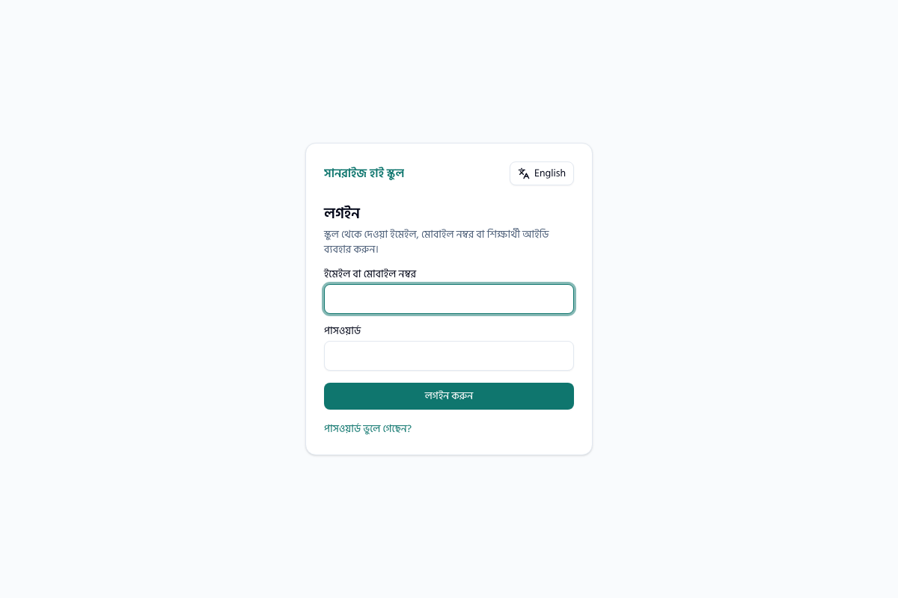

উপরের বারে **বাংলা / English** বোতামে পুরো সাইট ও ড্যাশবোর্ডের ভাষা বদলায়।

## অ্যাডমিন (অফিস)

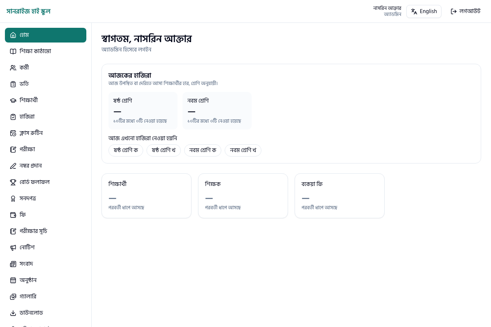

**বিদ্যালয়ের সেটিংস** — নাম, ঠিকানা, ফোন, লোগো, রং, EIIN, প্রধান শিক্ষকের বাণী। ওয়েবসাইট ও ছাপানো কাগজের সব তথ্য এখান থেকেই আসে। সংরক্ষণ করলে সাইট সঙ্গে সঙ্গে বদলে যায়।

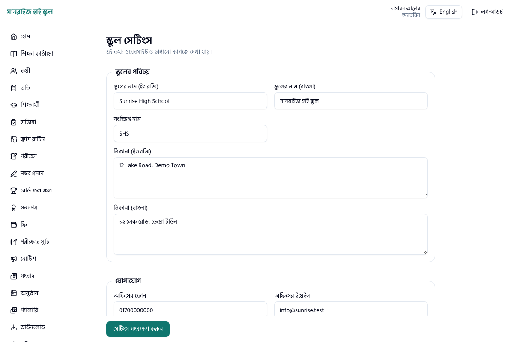

**ওয়েবসাইট:** নোটিশ, সংবাদ, অনুষ্ঠান, গ্যালারি, ডাউনলোড ও পাতা। প্রতিটিতে ইংরেজি ও বাংলা ট্যাব আছে; বাংলা খালি রাখলে ইংরেজিটি দেখানো হয়। **প্রকাশিত** টিক না দেওয়া পর্যন্ত খসড়া কেউ দেখে না। নোটিশের ধরন ও দর্শক (সবাই, শুধু কর্মী, বা একটি শ্রেণি) ঠিক করা যায়। শিক্ষকেরা নোটিশের খসড়া লিখতে পারেন; অফিস প্রকাশ করে।

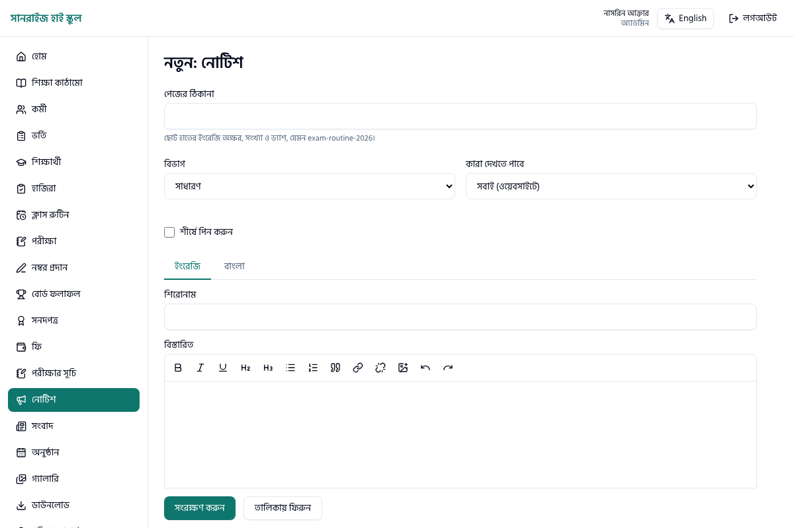

**ভর্তি:** অনলাইন আবেদনগুলো তালিকায় আসে। একটি খুলে কাগজপত্র দেখুন, ভর্তি পরীক্ষার তারিখ দিন, নম্বর লিখুন এবং একটি শাখায় **অনুমোদন** করুন। অনুমোদনে শিক্ষার্থী, অভিভাবক ও অভিভাবকের লগইন তৈরি হয় এবং এককালীন পাসওয়ার্ড একবারই দেখানো হয়: পরিবারের জন্য প্রিন্ট করুন বা লিখে রাখুন।

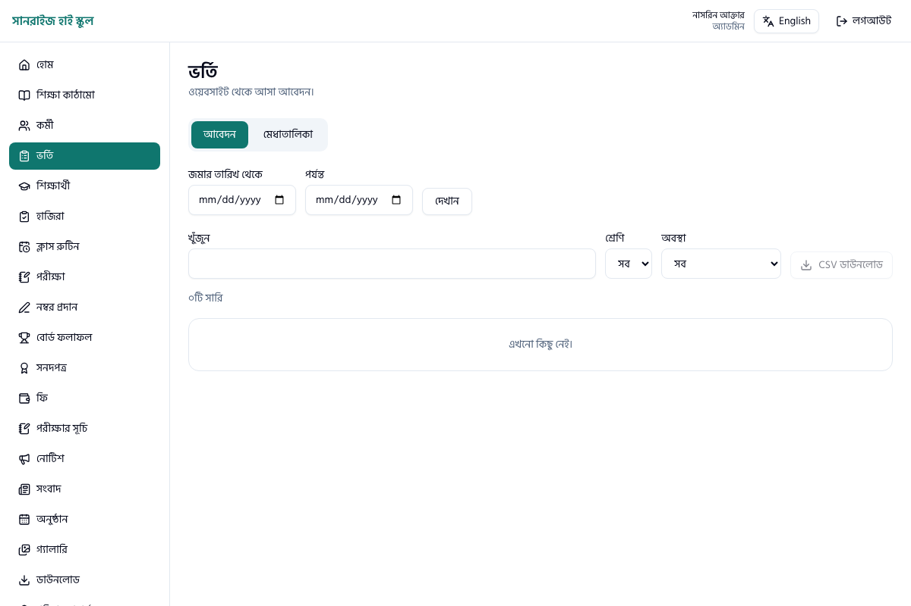

**শিক্ষার্থী:** খোঁজা, যোগ, সম্পাদনা, অভিভাবক যুক্ত করা, কাগজপত্র আপলোড, আইডি কার্ড প্রিন্ট, শিক্ষার্থী বা অভিভাবকের লগইন তৈরি, লগইন বন্ধ করা। **আমদানি** দিয়ে সিএসভি ফাইল থেকে অনেক শিক্ষার্থী একসাথে যোগ হয় (আগে নমুনা ফাইল নামান)। বছর শেষে **উত্তীর্ণকরণ** একটি শ্রেণিকে পরের সেশনে নেয়।

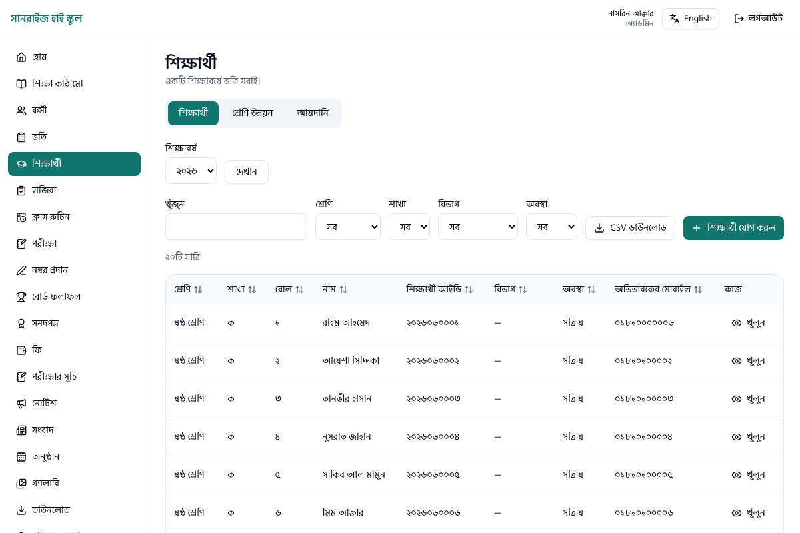

**কর্মী:** প্রোফাইল (প্রকাশ্য ও ব্যক্তিগত তথ্য), পদবি, পাঠদান বণ্টন (শাখা অনুযায়ী বিষয়) ও এককালীন পাসওয়ার্ডসহ লগইন। ব্যক্তিগত তথ্য (এনআইডি, জন্মতারিখ, ঠিকানা, ব্যক্তিগত ফোন) কখনো ওয়েবসাইটে আসে না।

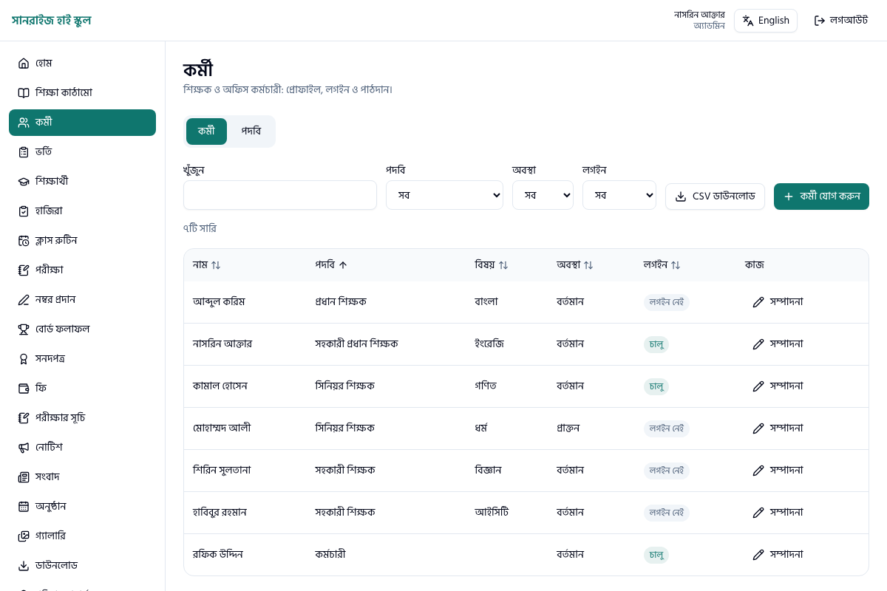

**একাডেমিক সেটআপ:** সেশন (একটি চলতি), শ্রেণি, শ্রেণিশিক্ষকসহ শাখা, গ্রুপ, বিষয় এবং কোন শ্রেণি কোন বিষয় পড়ে।

**পরীক্ষা:** পরীক্ষা তৈরি করুন, শ্রেণি ও বিষয়ভিত্তিক পূর্ণ ও পাস নম্বর দিন, **নম্বর এন্ট্রি**তে নিন যাতে শিক্ষকেরা নম্বর দিতে পারেন, তারপর **পর্যালোচনা**, **ফলাফল প্রক্রিয়া** ও **প্রকাশ**। প্রকাশিত ফলাফল অভিভাবক পোর্টালে ও ওয়েবসাইটের ফলাফল খোঁজায় দেখা যায়। ট্যাবুলেশন শিট ও মার্কশিট প্রিন্ট বা পিডিএফ হয়।

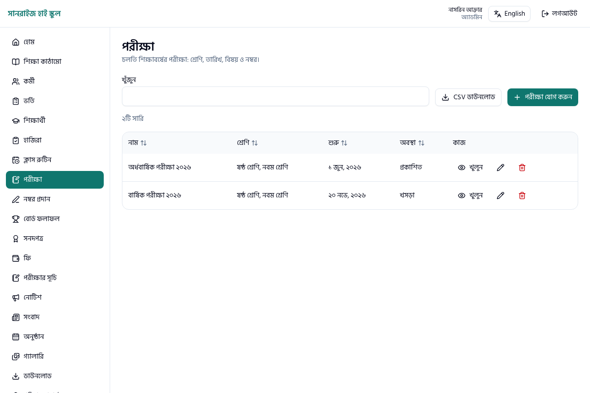

**রুটিন:** পিরিয়ড ও কর্মদিবস, ক্লাস রুটিন তৈরি (একই শিক্ষক বা কক্ষের সংঘর্ষ আটকে দেয়), পরীক্ষার রুটিন ও ছুটির ক্যালেন্ডার।

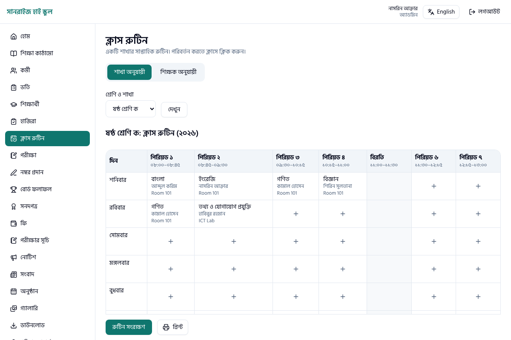

**সনদ:** শিক্ষার্থীর প্রশংসাপত্র, ছাড়পত্র বা চারিত্রিক সনদ, রেফারেন্স নম্বর ও কিউআর কোডসহ, যা যে কেউ ওয়েবসাইটে যাচাই করতে পারে। বাতিল সনদ বাতিল দেখায়।

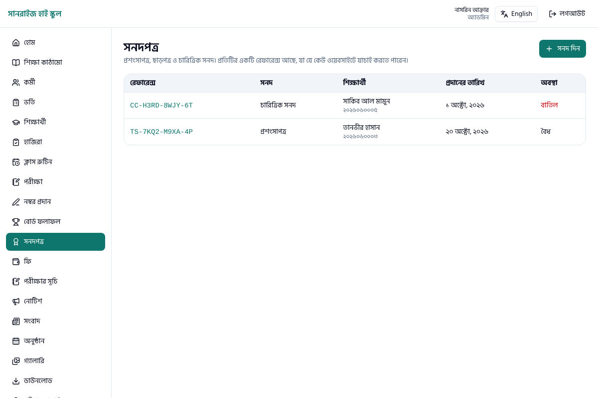

**ফি → ছাড়** অ্যাডমিনের অনুমোদন লাগে, এবং শুধু অ্যাডমিন পরিশোধ বাতিল বা অনলাইন পরিশোধ চালু করতে পারেন।

## শিক্ষক

**উপস্থিতি:** আপনার শাখা ও তারিখ বাছুন (ডিফল্ট আজ; গত ৩ দিন সংশোধন করা যায়)। সবাই শুরুতে উপস্থিত; কোনো শিক্ষার্থীতে চাপলে অনুপস্থিত, বিলম্ব বা ছুটি হয়। **সংরক্ষণ** করুন। ফোনে কাজ করে।

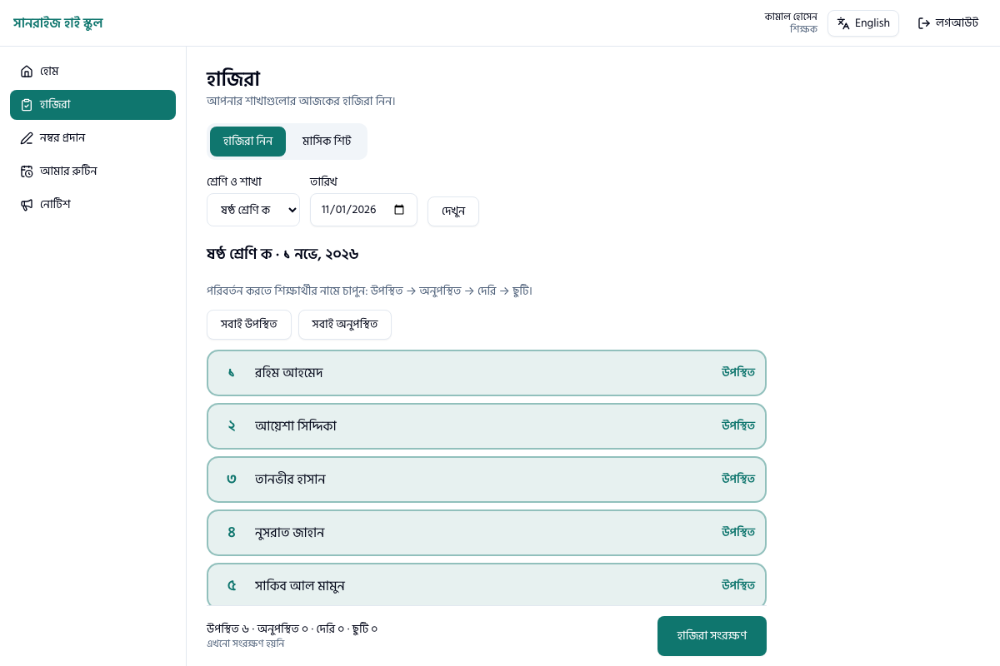

**নম্বর:** পরীক্ষা, আপনার শাখা ও বিষয় বাছুন। অংশ অনুযায়ী (সৃজনশীল, বহুনির্বাচনি, ব্যবহারিক) নম্বর লিখুন বা **অনুপস্থিত** টিক দিন; লেখার সাথে সাথে সংরক্ষিত হয়। সব নম্বর দেওয়া হলে **জমা দিন ও লক করুন**। শুধু অফিস আনলক করতে পারে। নমুনা থেকে তৈরি এক্সেল ফাইল থেকেও নম্বর আমদানি করা যায়।

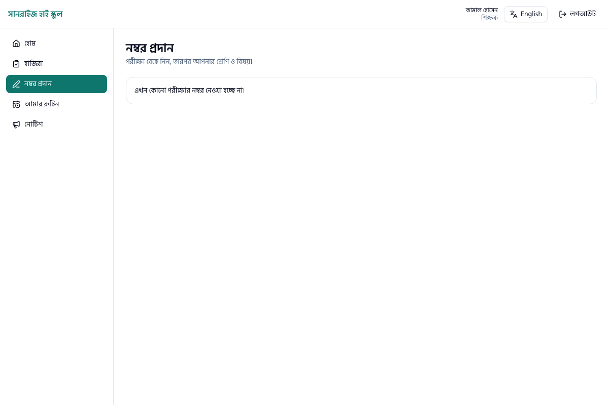

**নোটিশ:** খসড়া লিখুন; অফিস প্রকাশ করে। **আমার রুটিন**-এ নিজের সময়সূচি দেখা যায়।

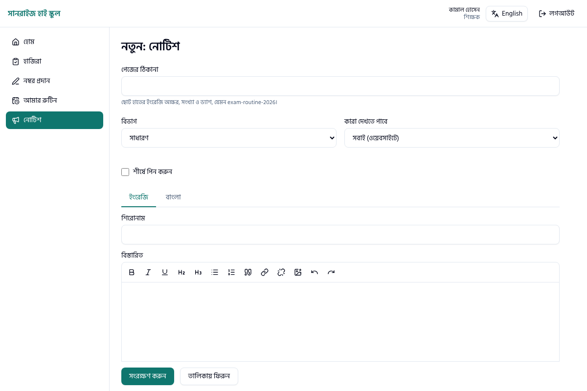

## হিসাবরক্ষক

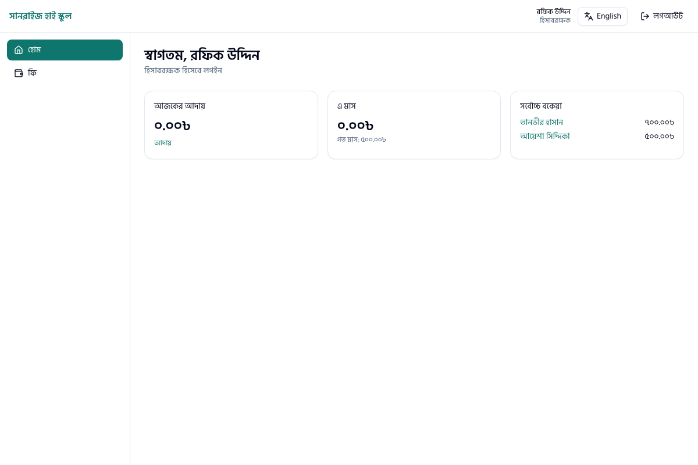

**ফি সেটআপ:** ফি খাত, শ্রেণি (ও গ্রুপ) অনুযায়ী ফি কাঠামো, ছাড় (অ্যাডমিন অনুমোদন করেন), বিলম্ব জরিমানা ও পরিশোধের ডিফল্ট সময়।

**বিল তৈরি:** একটি মাস (সব মাসিক ফি) বা এককালীন ফি ও শ্রেণি বেছে **প্রিভিউ** দেখুন: কতটি বিল ও মোট কত জানায়, এবং কোনো ছাড় অনুমোদনের অপেক্ষায় থাকলে সতর্ক করে। তারপর **তৈরি করুন**। আবার চালালে দ্বিতীয়বার কিছু তৈরি হয় না।

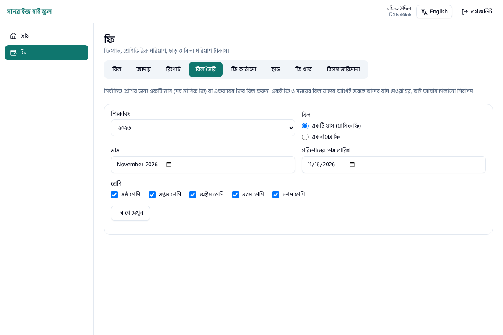

**আদায়:** আইডি, রোল বা নাম দিয়ে শিক্ষার্থী খুঁজুন। যে বিলগুলো পরিশোধ হচ্ছে টিক দিন, টাকার পরিমাণ লিখুন (আংশিক চলে), মাধ্যম এবং বিকাশ, নগদ বা রকেটের লেনদেন আইডি দিন, তারপর **সংরক্ষণ ও রসিদ প্রিন্ট**। বিলম্ব জরিমানা থাকলে এই মুহূর্তে যোগ হয়। রসিদে ইংরেজি ও বাংলায় কথায় টাকার পরিমাণ ও কিউআর কোড থাকে; প্রিন্ট করুন বা পিডিএফ নামান।

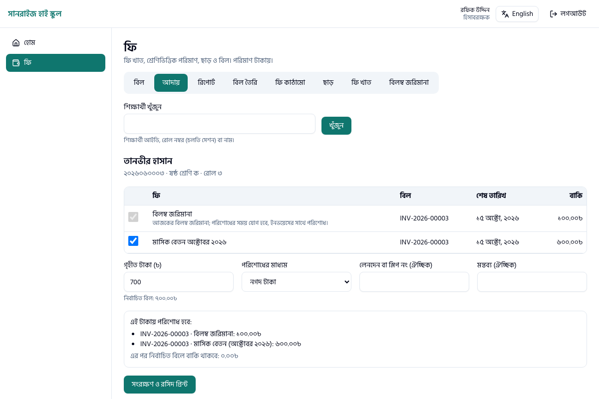

**রিপোর্ট:** দৈনিক আদায় (মাধ্যম ও গ্রহণকারী অনুযায়ী), অভিভাবকের ফোনসহ শ্রেণিভিত্তিক বকেয়া, নির্দিষ্ট সময়ের ফি অনুযায়ী আয় এবং শিক্ষার্থীর খতিয়ান। প্রতিটি এক্সেল বা পিডিএফে নামানো যায়।

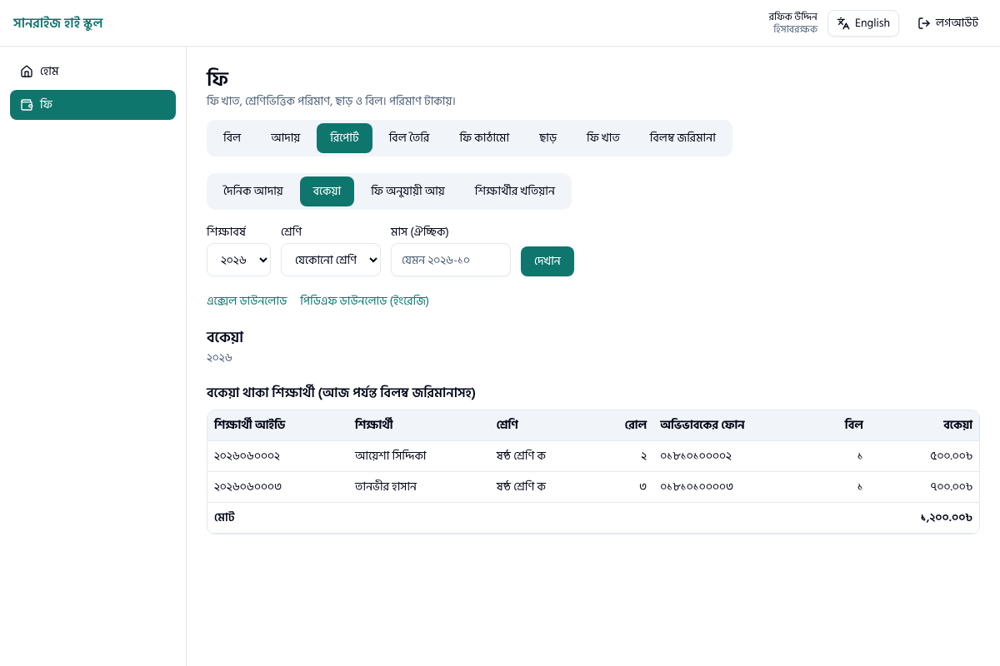

## অভিভাবক

**আমার সন্তান**-এ প্রতিটি সন্তানের উপস্থিতি ক্যালেন্ডার, ফলাফল ও ফি-র লিংক থাকে।

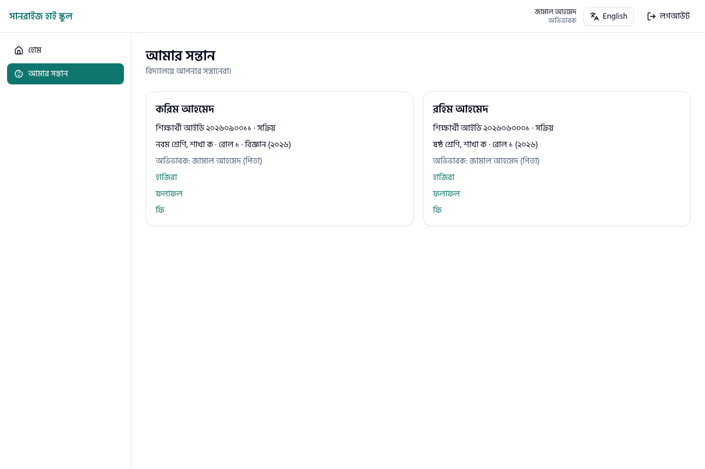

**উপস্থিতি:** মাসের শতাংশসহ ক্যালেন্ডার।

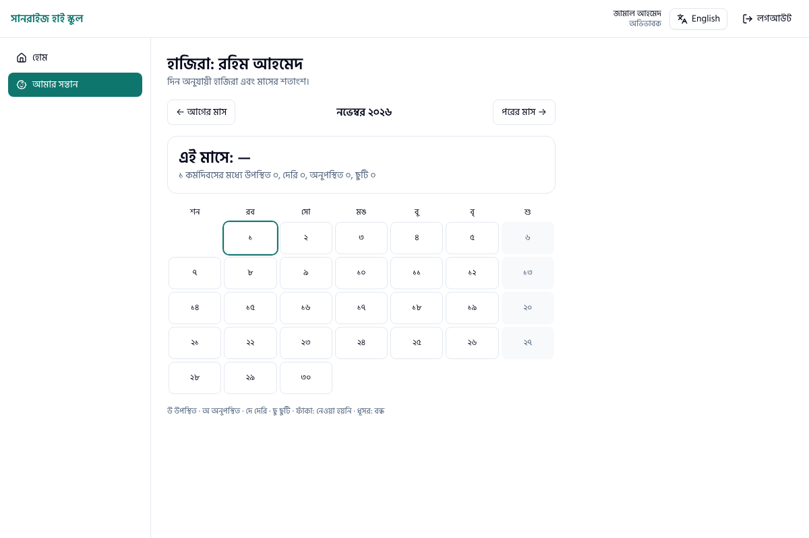

**ফলাফল:** প্রকাশিত পরীক্ষাগুলো; একটি খুললে মার্কশিট, যা প্রিন্ট করা যায়।

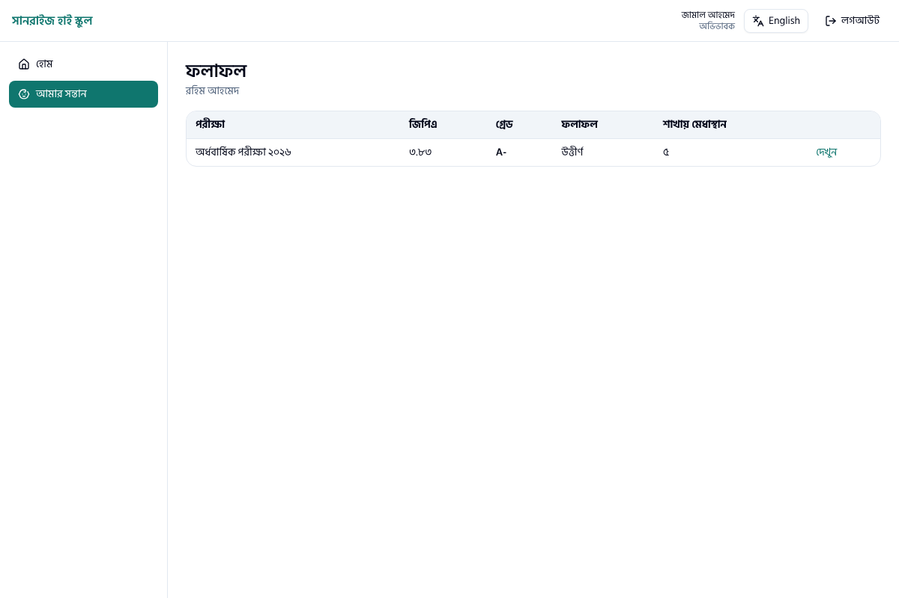

**ফি:** এখন কত বকেয়া, সব বিল ও সব রসিদ (একটি খুলে প্রিন্ট বা ডাউনলোড)। বিদ্যালয় অনলাইন পরিশোধ চালু করলে **এখনই পরিশোধ করুন** দিয়ে গেটওয়ের মাধ্যমে সব বকেয়া পরিশোধ করা যায়।

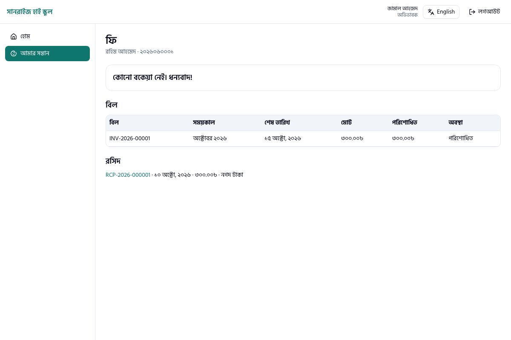

## শিক্ষার্থী

শিক্ষার্থী আইডি দিয়ে লগইন। **আমার প্রোফাইল**-এ অভিভাবকের মতোই নিজের উপস্থিতি, ফলাফল ও ফি-র পাতা দেখা যায়।
